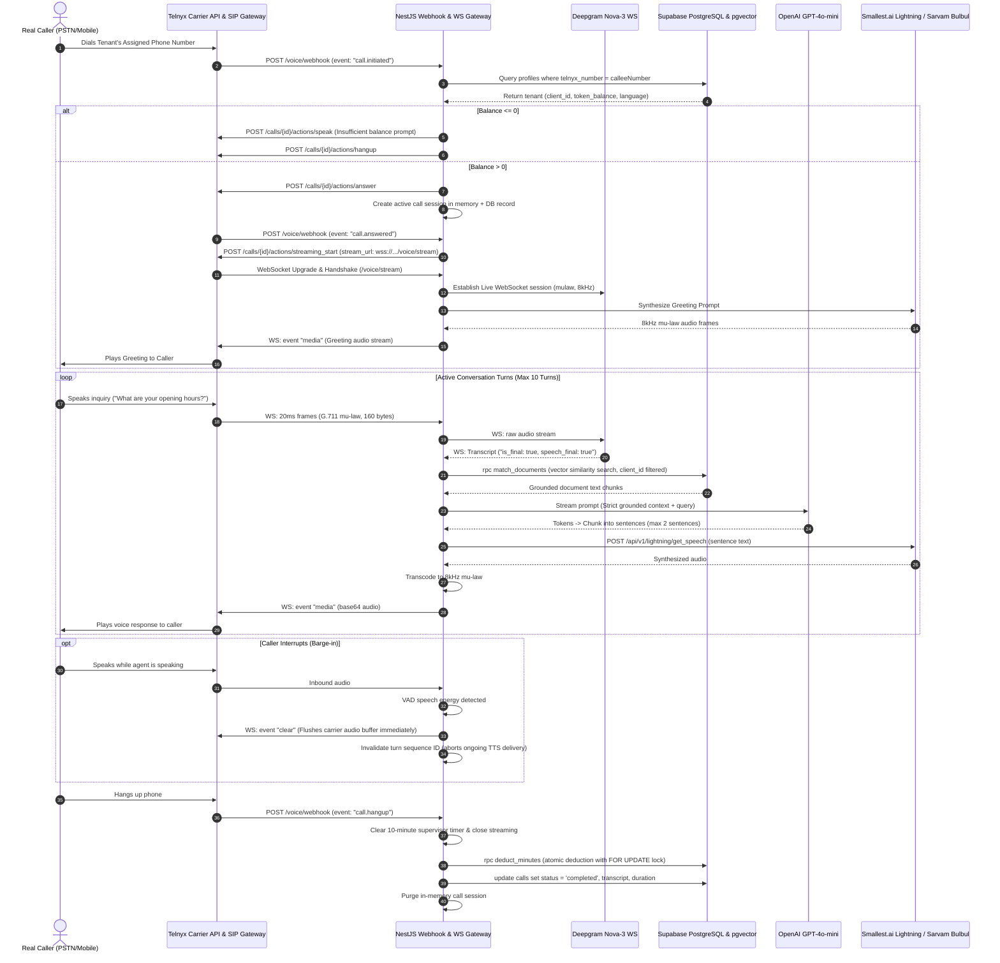

# System Architecture & Technical Specifications

---

## 1. End-to-End Inbound Call Lifecycle

The following sequence diagram outlines the exact flow of an inbound telephone call through the platform:



---

## 2. Core Service Responsibilities

### 2.1 CallsService (`backend/src/voice/calls.service.ts`)
* Acts as the stateful call supervisor for ongoing telephony sessions.
* Manages `activeCalls` (in-memory map indexed by `call_control_id`), hard duration timers (`activeCallTimers`), and transient audio caches.
* Performs caller number lookup in `profiles` to resolve the single tenant associated with the dialed number.
* Enforces duration checks: terminates calls exceeding 600 seconds, and appends the 3-minute remaining warning at 420 seconds.
* Tracks conversational turns (caps session at 10 turns to prevent toll runaway).

### 2.2 MediaStreamGateway & MediaStreamService (`backend/src/voice/`)
* Attaches directly to NestJS's underlying Node HTTP server to intercept WebSocket upgrade requests for `/voice/stream` and `/voice/media-stream`.
* Manages bidirectional packet streaming:
  * Inbound: decodes 8kHz G.711 mu-law to Linear PCM16 for Energy RMS VAD and forward raw packets to Deepgram Nova-3.
  * Outbound: chunks 16-bit PCM into 160-byte mu-law frames (20ms) and pushes `event: 'media'` JSON frames over the WebSocket.
* Implements `clearAudioBuffer(callControlId)`: immediately pushes `{"event": "clear", "streamSid": "...", "stream_id": "..."}` over the WebSocket when speech energy exceeds the VAD threshold, instantly stopping agent speech on the caller's phone.

### 2.3 ConversationService (`backend/src/voice/conversation.service.ts`)
* Executes semantic search using OpenAI `text-embedding-3-small` against Supabase `document_embeddings`.
* Executes `match_documents` RPC with cosine similarity filtering.
* Validates every retrieved chunk against `clientId` to guarantee tenant isolation; cross-tenant chunks trigger a critical security drop.
* Invokes OpenAI GPT-4o-mini with system prompts that strictly prohibit answering from external knowledge.
* Implements `generateResponseStream` which accumulates tokens and splits text into discrete sentences using punctuation boundaries (`.`, `!`, `?`, `।`), streaming completed sentences to TTS before the full completion finishes.

### 2.4 DeepgramService (`backend/src/deepgram/deepgram.service.ts`)
* Manages Deepgram Nova-3 connections.
* Provides `createLiveStream(callControlId, options)` to open persistent WebSockets with Deepgram (`encoding: 'mulaw'`, `sample_rate: 8000`, `endpointing: 300`, `smart_format: true`).
* Emits callbacks on interim transcripts and `speech_final` events.

### 2.5 SmallestService & SarvamService
* **SmallestService (`backend/src/smallest/smallest.service.ts`):** Calls `POST https://waves-api.smallest.ai/api/v1/lightning/get_speech` with `model: lightning`, `voice_id: emily`, `sample_rate: 24000`. Returns decoded audio buffers within ~150–250ms.
* **SarvamService (`backend/src/sarvam/sarvam.service.ts`):** Secondary fallback TTS (`bulbul:v3`) and fallback STT (`saaras:v3`) providing native Indic language fidelity (`hi-IN`).

---

## 3. Database Schema & RPC Functions

### 3.1 `profiles` Table
Stores tenant account settings, billing balances, and telephony routing:
* `id` (UUID, primary key matching Supabase Auth `user.id`).
* `telnyx_number` (TEXT, unique, e.g. `+18005550199`): Dialed number used by `CallsService.findClientByPhoneNumber`.
* `token_balance` (INTEGER): Available talk minutes.
* `agent_language` (TEXT): Default agent language (`English`, `Hindi`).
* `system_prompt` (TEXT): Optional tenant personality additions.

### 3.2 `calls` Table
Stores immutable historical call records:
* `id` (UUID, primary key).
* `client_id` (UUID, foreign key to `profiles.id`).
* `direction` (`inbound` | `outbound`).
* `caller_number`, `called_number` (TEXT).
* `telnyx_call_id` (TEXT, stores `call_control_id`).
* `duration_seconds` (INTEGER).
* `minutes_used` (INTEGER, ceiling of duration).
* `transcript` (JSONB, array of `{ role, content, timestamp }`).
* `status` (`in_progress`, `completed`, `failed`, `dropped`).

### 3.3 `deduct_minutes` RPC (ACID Balance Deduction)
```sql
CREATE OR REPLACE FUNCTION public.deduct_minutes(
  p_client_id UUID,
  p_minutes INTEGER
)
RETURNS JSONB
LANGUAGE plpgsql
SECURITY DEFINER
AS $$
DECLARE
  v_current_balance INTEGER;
  v_deducted INTEGER;
BEGIN
  IF p_minutes IS NULL OR p_minutes <= 0 THEN
    SELECT token_balance INTO v_current_balance FROM public.profiles WHERE id = p_client_id;
    RETURN jsonb_build_object('success', true, 'deducted', 0, 'remaining_balance', COALESCE(v_current_balance, 0));
  END IF;

  -- Row-level locking to prevent race conditions across concurrent calls
  SELECT token_balance INTO v_current_balance FROM public.profiles WHERE id = p_client_id FOR UPDATE;

  IF NOT FOUND THEN
    RETURN jsonb_build_object('success', false, 'error', 'profile_not_found');
  END IF;

  v_deducted := LEAST(COALESCE(v_current_balance, 0), p_minutes);
  UPDATE public.profiles SET token_balance = GREATEST(0, COALESCE(token_balance, 0) - v_deducted) WHERE id = p_client_id;

  RETURN jsonb_build_object(
    'success', true,
    'deducted', v_deducted,
    'remaining_balance', GREATEST(0, COALESCE(v_current_balance, 0) - v_deducted)
  );
END;
$$;
```
